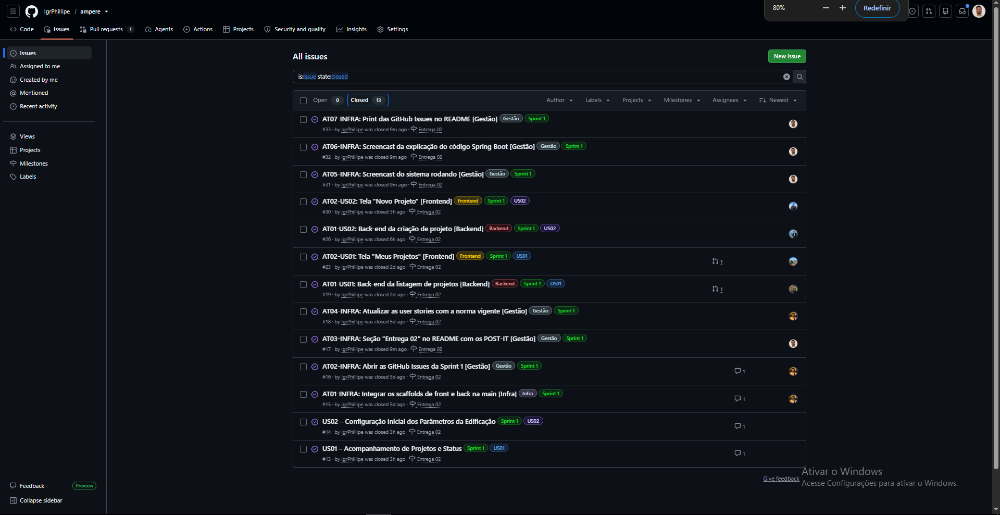
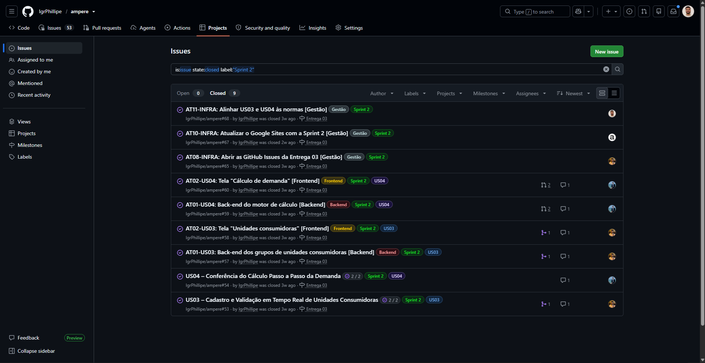
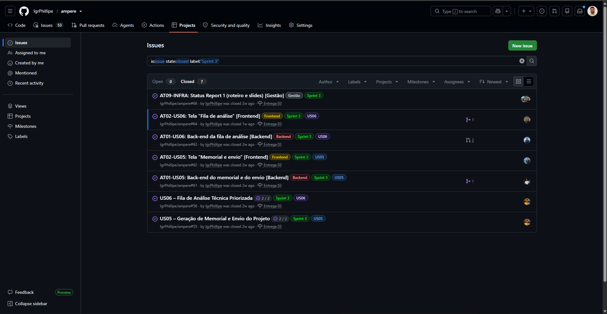

# AMPERE: Automação e Modelagem para Projetos de Energia em Redes Edificadas

O AMPERE automatiza o cálculo de demanda elétrica de edificações com múltiplas unidades consumidoras. A ferramenta aplica de forma padronizada as regras normativas vigentes da Neoenergia Pernambuco, elimina erros de interpretação das normas e reduz a reprovação de projetos por falhas de cálculo.

---

## Visão Geral

A Neoenergia Pernambuco recebe cerca de 1.400 projetos elétricos por ano de edificações com múltiplas unidades consumidoras. Cerca de 50 % são reprovados por erros no cálculo de demanda. A complexidade das tabelas, dos parâmetros e das regras normativas induz a erros tanto os clientes quanto as equipes de análise.

O AMPERE calcula a demanda com as regras normativas vigentes, sempre do mesmo modo, e registra a regra usada em cada etapa.

Detalhes em [`docs/negocio/premissas-desafio.md`](docs/negocio/premissas-desafio.md).

---

## Tecnologias

| Camada | Tecnologia | Papel |
| :--- | :--- | :--- |
| Back-end | Java e Spring Boot | API REST e motor de cálculo de demanda com classes de domínio |
| Banco de dados | PostgreSQL | Entidades persistidas e tabelas normativas versionadas por revisão |
| Front-end | React e Vite | Interface do projetista e do analista, consumindo a API |
| Prototipação | Figma | Protótipos Lo-Fi e Hi-Fi das telas dos dois perfis |
| Documentação | Markdown | Decisões, normas e processo, versionados junto com o código |
| Gestão | Trello e GitHub Issues | Backlog, issues e acompanhamento semanal |

Documentação por camada:

- [`app/back/README.md`](app/back/README.md)
- [`app/front/README.md`](app/front/README.md)
- [`docs/tecnico/README.md`](docs/tecnico/README.md)

---

## Descoberta e Análise

O projeto tem três fases: **Imersão**, **Ideação** e **Desenvolvimento do MVP** ([`docs/processo.md`](docs/processo.md)). A Imersão está concluída e produziu os documentos abaixo.

| Documento | Conteúdo |
| :--- | :--- |
| [Premissas do desafio](docs/negocio/premissas-desafio.md) | O desafio apresentado pela Neoenergia PE: problema, impacto e proposta de solução |
| [Análise de causa raiz](docs/negocio/analise-causa-raiz.md) | 5 Porquês e Ishikawa sobre a reprovação de projetos |
| [Benchmarking](docs/negocio/benchmarking.md) | COPEL, CEMIG, Enel, CPFL e AltoQi comparadas em 9 critérios. Nenhuma une cálculo e aprovação |
| [Objetivos do projeto](docs/produto/objetivos-projeto.md) | Metas do MVP e sua relação com a descoberta |
| [Mapa de stakeholders](docs/negocio/mapa-stakeholders.md) | Atores afetados, por proximidade com o problema e posição dentro ou fora da Neoenergia |
| [Processo de submissão](docs/negocio/processo-submissao.md) | Fluxo atual de envio, análise e devolução do projeto |
| [Fontes normativas](docs/tecnico/fontes-normativas.md) | DIS-NOR-053, DIS-NOR-030, metodologia de cálculo e revisões |
| [Questões em aberto](docs/produto/questoes-em-aberto.md) | Decisões pendentes para transformar objetivos em requisitos |

---

## Deploy

| Ambiente | URL |
| :--- | :--- |
| Front-end | https://ampere-virid.vercel.app |
| Back-end (API) | https://ampere-4eyz.onrender.com/api |

---

## Como Rodar

O front consome a API real, e a API persiste as classes de domínio no PostgreSQL.

**Back-end** (Java 21, Spring Boot e PostgreSQL). Requer Docker.

```bash
cd app/back && cp .env.example .env && docker compose up
```

A API sobe em `http://localhost:8080/api`, com a documentação em `/api/docs`. Com a JDK 21 instalada, a aplicação também roda localmente contra o banco em container. Detalhes em [`app/back/README.md`](app/back/README.md).

**Front-end** (React 19, Vite e TypeScript). Requer Node 24+ e pnpm.

```bash
cd app/front && cp .env.example .env && pnpm install && pnpm dev
```

O front sobe em `http://localhost:5173` e faz proxy de `/api` para o back-end, que precisa estar rodando. Credenciais de teste e comandos em [`app/front/README.md`](app/front/README.md).

**Tudo junto.** Com os dois `.env` criados e as dependências do front instaladas, a raiz sobe banco, API e front num terminal só. `Ctrl+C` derruba os três.

```bash
pnpm install && pnpm dev
```

---

## Entregas

| Entrega | Data | Situação |
| :--- | :--- | :--- |
| [Entrega 01](#entrega-01) | 31/08/2026 | Finalizada |
| [Entrega 02](#entrega-02) | 21/09/2026 | Finalizada |
| [Entrega 03](#entrega-03) | 19/10/2026 | Finalizada |
| [Entrega 04](#entrega-04) | 09/11/2026 | Finalizada |

Critérios de cada entrega: [`docs/cronograma-poo.md`](docs/cronograma-poo.md) (POO) e [`docs/cronograma-projetos3.md`](docs/cronograma-projetos3.md) (Projetos 3).

### Entrega 01

- **Data:** 31/08/2026
- **Escopo:** 7 histórias de usuário em BDD, protótipo Lo-Fi das duas jornadas e screencast do protótipo.

#### Artefatos

| Artefato | Link |
| :--- | :--- |
| Histórias de usuário | [`docs/produto/user-stories.md`](docs/produto/user-stories.md) |
| Protótipo Lo-Fi | [Figma](https://www.figma.com/design/gSwTyjY0iSzmDNAe4s6XeE/Prot%C3%B3tipo-LO-FI?node-id=18-4) |
| Screencast do protótipo | [YouTube](https://youtu.be/OI0QDboGtk4) |

#### Histórias e Telas

| História | Título | Perfil | Telas no protótipo Hi-Fi |
| :---: | :--- | :---: | :--- |
| US01 | [Acompanhamento de projetos e status](docs/produto/user-stories.md#us01-acompanhamento-de-projetos-e-status) | Projetista | [H1: Meus projetos](https://www.figma.com/design/tbMeH3sx9YwDVb6oz7bCBG/Prot%C3%B3tipo-HI-FI?node-id=2037-2)<br>[H1a: Busca sem resultados](https://www.figma.com/design/tbMeH3sx9YwDVb6oz7bCBG/Prot%C3%B3tipo-HI-FI?node-id=2118-2)<br>[H1b: Detalhes](https://www.figma.com/design/tbMeH3sx9YwDVb6oz7bCBG/Prot%C3%B3tipo-HI-FI?node-id=2155-2) |
| US02 | [Configuração inicial dos parâmetros da edificação](docs/produto/user-stories.md#us02-configuração-inicial-dos-parâmetros-da-edificação) | Projetista | [H2: Novo projeto](https://www.figma.com/design/tbMeH3sx9YwDVb6oz7bCBG/Prot%C3%B3tipo-HI-FI?node-id=2042-2) |
| US03 | [Cadastro e validação em tempo real de UCs](docs/produto/user-stories.md#us03-cadastro-e-validação-em-tempo-real-de-unidades-consumidoras) | Projetista | [H3: Unidades consumidoras](https://www.figma.com/design/tbMeH3sx9YwDVb6oz7bCBG/Prot%C3%B3tipo-HI-FI?node-id=2044-2)<br>[H3a: Adicionar grupo](https://www.figma.com/design/tbMeH3sx9YwDVb6oz7bCBG/Prot%C3%B3tipo-HI-FI?node-id=2152-2) |
| US04 | [Conferência do cálculo passo a passo da demanda](docs/produto/user-stories.md#us04-conferência-do-cálculo-passo-a-passo-da-demanda) | Projetista | [H4: Cálculo de demanda](https://www.figma.com/design/tbMeH3sx9YwDVb6oz7bCBG/Prot%C3%B3tipo-HI-FI?node-id=2032-2) |
| US05 | [Geração de memorial e envio do projeto](docs/produto/user-stories.md#us05-geração-de-memorial-e-envio-do-projeto) | Projetista | [H5: Memorial](https://www.figma.com/design/tbMeH3sx9YwDVb6oz7bCBG/Prot%C3%B3tipo-HI-FI?node-id=2045-2)<br>[H5b: Envio concluído](https://www.figma.com/design/tbMeH3sx9YwDVb6oz7bCBG/Prot%C3%B3tipo-HI-FI?node-id=2147-2) |
| US06 | [Fila de análise técnica priorizada](docs/produto/user-stories.md#us06-fila-de-análise-técnica-priorizada) | Analista | [H6: Fila de análise](https://www.figma.com/design/tbMeH3sx9YwDVb6oz7bCBG/Prot%C3%B3tipo-HI-FI?node-id=2082-2) |
| US07 | [Auditoria de memória e registro de apontamentos](docs/produto/user-stories.md#us07-auditoria-de-memória-e-registro-pontual-de-apontamentos) | Analista | [H7: Análise do projeto](https://www.figma.com/design/tbMeH3sx9YwDVb6oz7bCBG/Prot%C3%B3tipo-HI-FI?node-id=2083-2)<br>[H8: Histórico do protocolo](https://www.figma.com/design/tbMeH3sx9YwDVb6oz7bCBG/Prot%C3%B3tipo-HI-FI?node-id=2085-2) |

---

### Entrega 02

- **Data:** 21/09/2026
- **Escopo:** US01 e US02 implementadas com back-end Spring Boot, front-end React e PostgreSQL.

#### Histórias Implementadas

##### US01: Acompanhamento de Projetos e Status

> **Como** projetista externo,  
> **Quero** acompanhar todos os meus projetos e o status de cada um em um painel centralizado,  
> **Para que** eu saiba exatamente quais exigem ação sem depender de e-mail ou telefone.

| Item | Descrição |
| :--- | :--- |
| **Entregue** | Listagem com nome, endereço, quantidade de UCs, demanda, status e última atualização<br>Filtros por situação com contagem, preservados na URL<br>Busca por nome ou protocolo<br>Estado vazio "Nenhum projeto encontrado para os critérios informados"<br>Atalho "Corrigir" nos projetos reprovados |
| **Back-end** | [`ProjectController`](app/back/src/main/java/br/com/ampere/controller/ProjectController.java), [`ProjectListing`](app/back/src/main/java/br/com/ampere/service/ProjectListing.java) |
| **Front-end** | [`ProjectsPage`](app/front/src/features/projects/pages/ProjectsPage/ProjectsPage.tsx) |
| **Issues** | [#13](https://github.com/IgrPhillipe/ampere/issues/13), [#19](https://github.com/IgrPhillipe/ampere/issues/19), [#23](https://github.com/IgrPhillipe/ampere/issues/23) |

##### US02: Configuração Inicial dos Parâmetros da Edificação

> **Como** projetista externo,  
> **Quero** informar os parâmetros da edificação uma única vez,  
> **Para que** o próprio sistema determine automaticamente a norma e as tabelas aplicadas ao cálculo, eliminando divergências de interpretação.

| Item | Descrição |
| :--- | :--- |
| **Entregue** | Formulário de identificação e parâmetros técnicos<br>Campos obrigatórios bloqueiam o avanço<br>DIS-NOR-053 REV 06 e DIS-NOR-030 REV 07 atribuídas a partir do tipo de edificação, sem seleção manual<br>Norma persistida junto do projeto |
| **Back-end** | [`BuildingType`](app/back/src/main/java/br/com/ampere/domain/BuildingType.java) e subclasses, [`ApplicableStandards`](app/back/src/main/java/br/com/ampere/service/ApplicableStandards.java), [`ProjectCreation`](app/back/src/main/java/br/com/ampere/service/ProjectCreation.java) |
| **Front-end** | [`ProjectDataPage`](app/front/src/features/projects/pages/ProjectDataPage/ProjectDataPage.tsx) |
| **Issues** | [#14](https://github.com/IgrPhillipe/ampere/issues/14), [#26](https://github.com/IgrPhillipe/ampere/issues/26), [#30](https://github.com/IgrPhillipe/ampere/issues/30) |

#### Requisitos de POO

| Requisito | Onde é atendido |
| :--- | :--- |
| Mínimo de 3 classes de domínio persistidas | `Project`, `BuildingType`, `Standard`, `Finding` e `User` |
| Histórias que leem e escrevem no banco | US02 grava o projeto; US01 lê a listagem |
| **Herança** | `BuildingType` abstrata, estendida por `ResidentialMultifamily`, `NonResidential` e `Mixed` |
| **Polimorfismo** | Cada subclasse sobrescreve `demandRules()`. A norma aplicável é derivada dessas regras, sem condicional por tipo |
| **Encapsulamento** | Campos privados, invariantes validadas no construtor e nenhum setter sem uso |
| Sem geração automática de código | Lombok proibido. DTOs são `record` e as entidades têm getters escritos à mão |

#### Artefatos

| Artefato | Link |
| :--- | :--- |
| Histórias implementadas (POST-IT) | [Histórias implementadas](#histórias-implementadas) |
| Print do GitHub Issues |  |
| Screencast do sistema | [YouTube, parte 1](https://youtu.be/YMnBWUuncdQ)<br>[YouTube, parte 2](https://youtu.be/6X58x5Wv9ho) |
| Screencast da explicação do código | [YouTube, parte 1](https://youtu.be/_4FRXZAnfkg)<br>[YouTube, parte 2](https://youtu.be/_nDhOTqJTPY) |

---

### Entrega 03

- **Data:** 19/10/2026
- **Escopo:** US03 e US04 na Sprint 2 (20/09 a 26/09); US05 e US06 na Sprint 3 (27/09 a 03/10).
- **Planejamento:** [`docs/produto/plano-entrega-03.md`](docs/produto/plano-entrega-03.md) e [milestone Entrega 03](https://github.com/IgrPhillipe/ampere/milestone/2).

#### Histórias Implementadas

##### US03: Cadastro e Validação em Tempo Real de Unidades Consumidoras

> **Como** projetista externo,  
> **Quero** cadastrar as unidades consumidoras agrupadas por tipo e receber validações técnicas instantâneas,  
> **Para que** eu possa corrigir inconsistências antes da submissão formal.

| Item | Descrição |
| :--- | :--- |
| **Entregue** | Grupos de unidades por tipo: residencial, cargas de área comum ou comerciais e recarga de veículo elétrico<br>Situação de cada grupo (validado, revisar, falta dado) conforme DIS-NOR-053 e DIS-NOR-030<br>Painel de validação em tempo real, com as pendências que bloqueiam o cálculo e atalho para corrigir<br>"Calcular demanda" liberado somente sem pendências |
| **Back-end** | [`ConsumerUnitGroup`](app/back/src/main/java/br/com/ampere/domain/ConsumerUnitGroup.java) e subclasses, [`ConsumerUnitGroupController`](app/back/src/main/java/br/com/ampere/controller/ConsumerUnitGroupController.java) |
| **Front-end** | [`ConsumerUnitsPage`](app/front/src/features/projects/pages/ConsumerUnitsPage/ConsumerUnitsPage.tsx) |
| **Issues** | [#53](https://github.com/IgrPhillipe/ampere/issues/53), [#57](https://github.com/IgrPhillipe/ampere/issues/57), [#58](https://github.com/IgrPhillipe/ampere/issues/58), [#68](https://github.com/IgrPhillipe/ampere/issues/68) |

##### US04: Conferência do Cálculo Passo a Passo da Demanda

> **Como** projetista externo,  
> **Quero** visualizar a memória de cálculo de demanda detalhada passo a passo com a regra normativa usada,  
> **Para que** eu possa auditar o dimensionamento e sustentá-lo tecnicamente.

| Item | Descrição |
| :--- | :--- |
| **Entregue** | Motor de cálculo com as parcelas Drf, Ds, Dc e Dve e a demanda total Ded (DIS-NOR-053 Anexo I e DIS-NOR-030)<br>Memória de cálculo por etapa, com fórmula, valores e tabela normativa aplicada<br>Painel de rastreabilidade: demanda calculada, mínimo por tensão, corrente, padrão de entrada, proteção geral e ramal<br>Cada cálculo gravado com as revisões das normas e as tabelas aplicadas no momento<br>Tabelas normativas no banco, cadastradas e aprovadas por pessoas diferentes na área administrativa<br>Exemplos 1 e 2 do Anexo I da DIS-NOR-053 como testes de regressão |
| **Back-end** | [`DemandEngine`](app/back/src/main/java/br/com/ampere/domain/DemandEngine.java), [`Calculation`](app/back/src/main/java/br/com/ampere/domain/Calculation.java), [`NormativeTable`](app/back/src/main/java/br/com/ampere/domain/NormativeTable.java), [`DemandCalculationController`](app/back/src/main/java/br/com/ampere/controller/DemandCalculationController.java), [`NormativeTableController`](app/back/src/main/java/br/com/ampere/controller/NormativeTableController.java) |
| **Front-end** | [`CalculationPage`](app/front/src/features/projects/pages/CalculationPage/CalculationPage.tsx), [`NormativeTablesPage`](app/front/src/features/normative-tables/pages/NormativeTablesPage/NormativeTablesPage.tsx) |
| **Issues** | [#54](https://github.com/IgrPhillipe/ampere/issues/54), [#59](https://github.com/IgrPhillipe/ampere/issues/59), [#60](https://github.com/IgrPhillipe/ampere/issues/60), [#68](https://github.com/IgrPhillipe/ampere/issues/68) |

##### US05: Geração de Memorial e Envio do Projeto

> **Como** projetista externo,  
> **Quero** gerar o memorial descritivo padronizado no formato da Neoenergia e validar o checklist documental,  
> **Para que** a submissão ocorra sem risco de reprovação por documentação incompleta.

| Item | Descrição |
| :--- | :--- |
| **Entregue** | Memorial descritivo de cálculo de demanda em PDF, com prévia na tela e download, na identidade visual do sistema<br>Checagem antes do envio: cálculo concluído e anexos obrigatórios (ART, diagrama unifilar e planta de situação)<br>"Enviar para Análise" liberado somente com o checklist completo<br>Envio registra a data e muda o status para "Em análise" |
| **Back-end** | [`SubmissionService`](app/back/src/main/java/br/com/ampere/service/SubmissionService.java), [`SubmissionChecklist`](app/back/src/main/java/br/com/ampere/service/SubmissionChecklist.java), [`ProjectDocument`](app/back/src/main/java/br/com/ampere/domain/ProjectDocument.java), [`MemorialPdfService`](app/back/src/main/java/br/com/ampere/service/MemorialPdfService.java), [`SubmissionController`](app/back/src/main/java/br/com/ampere/controller/SubmissionController.java) |
| **Front-end** | [`MemorialPage`](app/front/src/features/projects/pages/MemorialPage/MemorialPage.tsx), [`ProjectDetailPage`](app/front/src/features/projects/pages/ProjectDetailPage/ProjectDetailPage.tsx) |
| **Issues** | [#55](https://github.com/IgrPhillipe/ampere/issues/55), [#61](https://github.com/IgrPhillipe/ampere/issues/61), [#62](https://github.com/IgrPhillipe/ampere/issues/62) |

##### US06: Fila de Análise Técnica Priorizada

> **Como** analista da Neoenergia,  
> **Quero** visualizar a fila de projetos ordenada por prazo de vencimento e pré-validada pelo sistema,  
> **Para que** eu possa priorizar os atendimentos críticos e focar a análise no julgamento técnico humano.

| Item | Descrição |
| :--- | :--- |
| **Entregue** | Fila dos projetos em análise ordenada pela urgência do prazo de 30 dias: atrasado, vence hoje ou no prazo<br>Indicadores no topo: todos na fila, vencendo o prazo, acima de 50 kVA e reanálise, que também filtram a listagem<br>Alertas da pré-validação do último cálculo em cada projeto<br>Busca por protocolo, projetista ou município<br>"Analisar" abre a análise do projeto |
| **Back-end** | [`ReviewQueueService`](app/back/src/main/java/br/com/ampere/service/ReviewQueueService.java), [`ReviewQueueListing`](app/back/src/main/java/br/com/ampere/service/ReviewQueueListing.java), [`DeadlineStatus`](app/back/src/main/java/br/com/ampere/domain/DeadlineStatus.java), [`ReviewQueueController`](app/back/src/main/java/br/com/ampere/controller/ReviewQueueController.java) |
| **Front-end** | [`ReviewQueuePage`](app/front/src/features/review-queue/pages/ReviewQueuePage/ReviewQueuePage.tsx) |
| **Issues** | [#56](https://github.com/IgrPhillipe/ampere/issues/56), [#63](https://github.com/IgrPhillipe/ampere/issues/63), [#64](https://github.com/IgrPhillipe/ampere/issues/64) |

#### Requisitos de POO

| Requisito | Onde é atendido |
| :--- | :--- |
| Classes de domínio persistidas | `ConsumerUnitGroup` e subclasses, `Calculation`, `NormativeTable` e `ProjectDocument` |
| Histórias que leem e escrevem no banco | US03 grava e lê os grupos; US04 lê as tabelas publicadas e grava o cálculo; US05 grava os anexos e o envio; US06 lê a fila dos projetos em análise |
| **Herança** | `ConsumerUnitGroup` abstrata, estendida por `ResidentialGroup`, `LoadGroup` e `EvChargingGroup` |
| **Polimorfismo** | Cada subclasse sobrescreve `validate()` e `demand()`. O `DemandEngine` percorre os grupos sem condicional por tipo. `DemandComponent` e `LoadCategory` implementam o cálculo em cada constante |
| **Encapsulamento** | `NormativeTable` muda de estado somente por `revise`, `publish` e `supersede`, e quem cadastra não publica. `Calculation` não tem setters |
| Sem geração automática de código | Lombok proibido. DTOs são `record` e as entidades têm getters escritos à mão |

#### Artefatos

| Artefato | Link |
| :--- | :--- |
| Histórias implementadas (POST-IT) | [Histórias implementadas](#histórias-implementadas-1) |
| Print do GitHub Issues (Sprint 2) |  |
| Print do GitHub Issues (Sprint 3) |  |
| Screencast do sistema | [YouTube](https://youtu.be/0YldcnTvi8g) |
| Screencast da explicação do código | [YouTube](https://youtu.be/EUo41qSNQ8I) |

---

### Entrega 04

- **Data:** 09/11/2026
- **Escopo:** US07, US08, US09, US12, US18 e US20, nas Sprints 4 a 6 (04/10 a 01/11).
- **Planejamento:** [`docs/produto/plano-entrega-04.md`](docs/produto/plano-entrega-04.md) e [milestone Entrega 04](https://github.com/IgrPhillipe/ampere/milestone/3).

#### Histórias Implementadas

##### US07: Auditoria de Memória e Registro Pontual de Apontamentos

> **Como** analista da Neoenergia,  
> **Quero** conferir a memória de cálculo pré-validada e registrar apontamentos vinculados diretamente à etapa do erro,  
> **Para que** o projetista corrija apenas o item divergente sem necessitar de retrabalho total.

| Item | Descrição |
| :--- | :--- |
| **Entregue** | "Analisar" atribui o projeto ao analista, e outro analista não assume o mesmo projeto<br>Análise com as abas Memória de Cálculo, Unidades Consumidoras, Documentos e Histórico, e visualizador dos PDFs anexados<br>Apontamentos com gravidade (bloqueante ou ajuste), etapa, referência ao grupo, à parcela ou ao documento, descrição e item da norma<br>Alerta da verificação automática vira apontamento com um clique<br>"Aprovar Projeto" só sem bloqueante aberto e "Reprovar com Apontamentos" só com apontamento, ambos com parecer<br>Na reanálise, "Aceitar Correção" ou "Reabrir" em cada apontamento |
| **Back-end** | [`Finding`](app/back/src/main/java/br/com/ampere/domain/Finding.java), [`ProjectReviewService`](app/back/src/main/java/br/com/ampere/service/ProjectReviewService.java), [`FindingService`](app/back/src/main/java/br/com/ampere/service/FindingService.java), [`ProjectReviewController`](app/back/src/main/java/br/com/ampere/controller/ProjectReviewController.java), [`FindingController`](app/back/src/main/java/br/com/ampere/controller/FindingController.java) |
| **Front-end** | [`ProjectReviewWorkspace`](app/front/src/features/review-queue/pages/ProjectReviewWorkspace), [`FindingsPanel`](app/front/src/features/review-queue/components/FindingsPanel) |
| **Issues** | [#94](https://github.com/IgrPhillipe/ampere/issues/94), [#95](https://github.com/IgrPhillipe/ampere/issues/95), [#96](https://github.com/IgrPhillipe/ampere/issues/96), [#205](https://github.com/IgrPhillipe/ampere/issues/205) |

##### US08: Linha do Tempo e Histórico do Protocolo

> **Como** analista da Neoenergia,  
> **Quero** consultar a linha do tempo e os indicadores de retrabalho do protocolo,  
> **Para que** eu possa acompanhar o histórico de versões e pendências antes de emitir a decisão final.

| Item | Descrição |
| :--- | :--- |
| **Entregue** | Eventos gravados na criação, no envio, na pré-validação, na atribuição, na decisão, nas respostas aos apontamentos e no reenvio<br>Linha do tempo com autor, papel (Projetista, Analista ou Sistema), versão e data, com a alternância "Mais Recente Primeiro"<br>Ciclo em dias e métricas de retrabalho do protocolo<br>Histórico visível ao analista e ao projetista dono do projeto |
| **Back-end** | [`ProjectEvent`](app/back/src/main/java/br/com/ampere/domain/ProjectEvent.java), [`ProjectEventService`](app/back/src/main/java/br/com/ampere/service/ProjectEventService.java), [`ProjectHistoryService`](app/back/src/main/java/br/com/ampere/service/ProjectHistoryService.java), [`ProjectRework`](app/back/src/main/java/br/com/ampere/service/ProjectRework.java), [`ProjectHistoryController`](app/back/src/main/java/br/com/ampere/controller/ProjectHistoryController.java) |
| **Front-end** | [`ProjectHistoryPage`](app/front/src/features/projects/pages/ProjectHistoryPage), [`ProjectTimeline`](app/front/src/features/projects/components/ProjectTimeline/ProjectTimeline.tsx), [`ReworkPanel`](app/front/src/features/projects/components/ReworkPanel/ReworkPanel.tsx) |
| **Issues** | [#102](https://github.com/IgrPhillipe/ampere/issues/102), [#103](https://github.com/IgrPhillipe/ampere/issues/103), [#104](https://github.com/IgrPhillipe/ampere/issues/104) |

##### US09: Correção de Apontamentos e Reenvio com Versionamento

> **Como** projetista externo,  
> **Quero** acessar a lista de apontamentos da reprovação, corrigir apenas as etapas indicadas e reenviar uma nova versão do projeto,  
> **Para que** eu não precise refazer o processo do zero.

| Item | Descrição |
| :--- | :--- |
| **Entregue** | "Corrigir", na listagem, abre os apontamentos e o parecer da reprovação<br>Lista por gravidade, com atalho para a etapa e o item apontado, e selo do apontamento dentro das etapas<br>Projeto reprovado volta a aceitar alteração de dados, unidades, cálculo e documentos<br>Resposta "Corrigido" ou "Contestar" em cada apontamento, com justificativa obrigatória na contestação<br>"Reenviar Projeto" exige o resumo das alterações e fica bloqueado com bloqueante sem resposta<br>O reenvio recalcula a demanda, incrementa a versão e devolve o projeto à fila como reanálise |
| **Back-end** | [`Finding`](app/back/src/main/java/br/com/ampere/domain/Finding.java), [`SubmissionService`](app/back/src/main/java/br/com/ampere/service/SubmissionService.java), [`SubmissionChecklist`](app/back/src/main/java/br/com/ampere/service/SubmissionChecklist.java), [`FindingController`](app/back/src/main/java/br/com/ampere/controller/FindingController.java) |
| **Front-end** | [`ProjectOverviewPage`](app/front/src/features/projects/pages/ProjectOverviewPage), [`ProjectFindingsOverview`](app/front/src/features/projects/components/ProjectFindingsOverview/ProjectFindingsOverview.tsx), [`StageFindingsNotice`](app/front/src/features/projects/components/StageFindingsNotice/StageFindingsNotice.tsx) |
| **Issues** | [#97](https://github.com/IgrPhillipe/ampere/issues/97), [#98](https://github.com/IgrPhillipe/ampere/issues/98), [#99](https://github.com/IgrPhillipe/ampere/issues/99) |

##### US12: Detalhe do Projeto e Histórico de Tratamento

> **Como** projetista externo,  
> **Quero** abrir qualquer projeto da minha listagem e ver o resumo e o histórico de tratamento,  
> **Para que** eu entenda em que ponto o projeto está e o que aconteceu com ele sem alternar entre telas.

| Item | Descrição |
| :--- | :--- |
| **Entregue** | "Ver Projeto" e "Corrigir" abrem a página única do projeto<br>Cabeçalho com responsável técnico, versão, apontamentos em aberto, unidades, demanda e última movimentação<br>Faixa "Projeto enviado em" com a data e o protocolo<br>Seções com URL própria, editáveis para o dono em rascunho ou reprovado e somente leitura para os demais<br>Seção "Histórico" com a linha do tempo da US08 |
| **Back-end** | [`ProjectService`](app/back/src/main/java/br/com/ampere/service/ProjectService.java), [`ProjectSummary`](app/back/src/main/java/br/com/ampere/service/ProjectSummary.java), [`ProjectController`](app/back/src/main/java/br/com/ampere/controller/ProjectController.java) |
| **Front-end** | [`ProjectWorkspace`](app/front/src/features/projects/components/ProjectWorkspace/ProjectWorkspace.tsx), [`ProjectDetailHeader`](app/front/src/features/projects/components/ProjectDetailHeader/ProjectDetailHeader.tsx), [`ProjectOverviewPage`](app/front/src/features/projects/pages/ProjectOverviewPage) |
| **Issues** | [#105](https://github.com/IgrPhillipe/ampere/issues/105), [#106](https://github.com/IgrPhillipe/ampere/issues/106), [#107](https://github.com/IgrPhillipe/ampere/issues/107) |

##### US18: Filtros e Ordenação das Listagens

> **Como** projetista ou analista,  
> **Quero** filtrar e ordenar as listagens pelos critérios que importam no meu trabalho,  
> **Para que** eu encontre rapidamente os projetos que preciso tratar.

| Item | Descrição |
| :--- | :--- |
| **Entregue** | "Meus Projetos" ordena por nome, demanda, criação e atualização, e filtra por município, período e apontamentos<br>Fila de análise ordena por prazo, envio, demanda e alertas, e filtra por analista e município<br>Ordenação pelo cabeçalho das colunas e filtros guardados na URL<br>Etiquetas removíveis dos filtros ativos e "Limpar Filtros"<br>Busca, situação e ordenação nas tabelas normativas<br>Endereço pelo CEP, limitado à área atendida pela Neoenergia Pernambuco, com filtros de UF e município |
| **Back-end** | [`ProjectListing`](app/back/src/main/java/br/com/ampere/service/ProjectListing.java), [`ProjectListQuery`](app/back/src/main/java/br/com/ampere/service/ProjectListQuery.java), [`ReviewQueueListing`](app/back/src/main/java/br/com/ampere/service/ReviewQueueListing.java), [`ReviewQueueQuery`](app/back/src/main/java/br/com/ampere/service/ReviewQueueQuery.java), [`NormativeTableQuery`](app/back/src/main/java/br/com/ampere/service/NormativeTableQuery.java), [`ConcessionArea`](app/back/src/main/java/br/com/ampere/domain/ConcessionArea.java) |
| **Front-end** | [`ProjectsPage`](app/front/src/features/projects/pages/ProjectsPage/ProjectsPage.tsx), [`ReviewQueuePage`](app/front/src/features/review-queue/pages/ReviewQueuePage/ReviewQueuePage.tsx), [`NormativeTablesPage`](app/front/src/features/normative-tables/pages/NormativeTablesPage/NormativeTablesPage.tsx) |
| **Issues** | [#108](https://github.com/IgrPhillipe/ampere/issues/108), [#109](https://github.com/IgrPhillipe/ampere/issues/109), [#110](https://github.com/IgrPhillipe/ampere/issues/110), [#177](https://github.com/IgrPhillipe/ampere/issues/177), [#181](https://github.com/IgrPhillipe/ampere/issues/181) |

##### US20: Exclusão de Projeto em Rascunho

> **Como** projetista externo,  
> **Quero** excluir projetos em rascunho que não vou mais enviar,  
> **Para que** minha listagem mostre apenas o que está em andamento.

| Item | Descrição |
| :--- | :--- |
| **Entregue** | "Excluir Projeto" só para rascunho, na listagem e no detalhe do projeto<br>Diálogo de confirmação com o nome e o protocolo<br>Listagem e contadores atualizados depois da exclusão<br>"Excluir Grupo" também pede confirmação |
| **Back-end** | `DELETE /api/projects/{id}` já existente em [`ProjectController`](app/back/src/main/java/br/com/ampere/controller/ProjectController.java), que apaga em cascata |
| **Front-end** | [`ProjectDeleteDialog`](app/front/src/features/projects/components/ProjectDeleteDialog/ProjectDeleteDialog.tsx), [`ProjectsPage`](app/front/src/features/projects/pages/ProjectsPage/ProjectsPage.tsx) |
| **Issues** | [#100](https://github.com/IgrPhillipe/ampere/issues/100), [#101](https://github.com/IgrPhillipe/ampere/issues/101) |

#### Requisitos de POO

| Requisito | Onde é atendido |
| :--- | :--- |
| Classes de domínio persistidas | `Finding` e `ProjectEvent`, além das entregas anteriores |
| Histórias que leem e escrevem no banco | US07 grava a atribuição, os apontamentos e a decisão; US08 grava e lê os eventos; US09 grava as respostas e a nova versão; US12 lê o resumo e o histórico; US18 lê as listagens filtradas; US20 apaga o rascunho |
| **Encapsulamento** | `Project` muda de status somente por `submit`, `approve`, `reject` e `assignReviewer`, sem setter. `Finding` muda somente por `publish`, `respond` e `resolve`. `ProjectEvent` é imutável |
| Sem geração automática de código | Lombok proibido. DTOs são `record` e as entidades têm getters escritos à mão |

#### Artefatos

| Artefato | Link |
| :--- | :--- |
| Histórias implementadas (POST-IT) | [Histórias implementadas](#histórias-implementadas-2) |
| Print do GitHub Issues | Pendente |
| Screencast final do sistema | [Youtube](https://youtu.be/uo62ex86vuQ) |
| Screencast da explicação do código | [Youtube](https://youtu.be/QCxPnMIqprI) |

---

## Links

| Área | Link |
| :--- | :--- |
| Deploy (front) | [Vercel](https://ampere-virid.vercel.app) |
| Deploy (API) | [Render](https://ampere-4eyz.onrender.com/api) |
| Site do grupo | [Google Sites](https://sites.google.com/cesar.school/site-grupo-4/) |
| Backlog | [GitHub Project](https://github.com/users/IgrPhillipe/projects/4) |
| Issues | [GitHub Issues](https://github.com/IgrPhillipe/ampere/issues) |
| Gestão do projeto | [Trello](https://trello.com/b/yd35ygrF/cesar-projetos-3) |
| Ideação | [FigJam](https://www.figma.com/board/H7ZlU9nAbR72LiXVLUBmqo) |
| Descoberta | [Figma](https://www.figma.com/files/team/1541129127160121770/project/636750169?fuid=1543015890914897932) |
| Protótipo Hi-Fi | [Figma](https://www.figma.com/design/tbMeH3sx9YwDVb6oz7bCBG/Prot%C3%B3tipo-HI-FI) |
| Protótipo Lo-Fi | [Figma](https://www.figma.com/design/gSwTyjY0iSzmDNAe4s6XeE/Prot%C3%B3tipo-LO-FI?node-id=18-4) |
| Drive | [Google Drive](https://drive.google.com/drive/u/1/folders/13xm3xImWBu0tH-wV9_ENizb65mgrkQ3l) |
| Cronograma de Projetos 3 | [`docs/cronograma-projetos3.md`](docs/cronograma-projetos3.md) |
| Cronograma de POO | [`docs/cronograma-poo.md`](docs/cronograma-poo.md) |

---

## Equipe e Papéis

| Nome | Papel | E-mail | Entrada | Saída | LinkedIn | GitHub |
| :--- | :--- | :--- | :--- | :--- | :--- | :--- |
| _Afonso Araujo_ | Engenheiro de Dados | ahma@cesar.school | 08/08/2026 | | [LinkedIn](https://www.linkedin.com/in/afonso-araujo-8ab810369/) | [GitHub](https://github.com/araujo1901mx) |
| _André Montenegro_ | Dev FullStack | agmos@cesar.school | 08/08/2026 | | [LinkedIn](https://www.linkedin.com/in/andr%C3%A9-montenegro-420132391/) | [GitHub](https://github.com/andre4383) |
| _Gabriel Boeckmann_ | Dev FullStack | gabs@cesar.school | 08/09/2026 | | [LinkedIn](https://www.linkedin.com/in/gabriel-araujo-boeckmann-e-silva/) | [GitHub](https://github.com/bielabs) |
| _Igor Aragão_ | Tech Lead e Dev FullStack | ipara@cesar.school | 08/08/2026 | | [LinkedIn](https://www.linkedin.com/in/igrphillipe/) | [GitHub](https://github.com/IgrPhillipe) |
| _Jean Augusto_ | Dev FullStack | jasm2@cesar.school | 08/08/2026 | | [LinkedIn](https://www.linkedin.com/in/jean-augusto-0562953b4/) | [GitHub](https://github.com/jeanaugustox) |
| _Kellwen Costa_ | Dev Back-End | kilc@cesar.school | 08/08/2026 | | [LinkedIn](https://www.linkedin.com/in/kellwencosta/) | [GitHub](https://github.com/kellwencosta) |
| _Lucas Gabriel_ | Dev FullStack | lgcs2@cesar.school | 08/08/2026 | | [LinkedIn](https://www.linkedin.com/in/lucasgabrielcs/) | [GitHub](https://github.com/lucasgabrielcs) |
| _Williams Pontes_ | Product Owner e Dev Back-End | jwlp@cesar.school | 08/08/2026 | | [LinkedIn](https://www.linkedin.com/in/williams-pontes/) | [GitHub](https://github.com/WillPontes) |

---

Projeto das disciplinas **Projetos 3** e **Programação Orientada a Objetos**, CESAR School, 2026.2.
Empresa parceira: **Neoenergia Pernambuco** (grupo Iberdrola).
